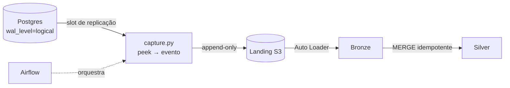

# lab-cdc

[](https://github.com/vitorpereirazp-code/lab-cdc/actions/workflows/ci.yml)


Laboratório de **Change Data Capture (CDC)** por log: uma réplica reduzida de uma
arquitetura de ingestão real. O objetivo é ver um `DELETE` atravessar o pipeline
inteiro, lendo o log do banco, sem consultar a tabela.



## Estrutura

```
lab-cdc/
├── .github/workflows/ci.yml   # lint + testes a cada push
├── infra/                     # banco de origem (Docker) e scripts SQL das etapas 1-2
├── src/lab_cdc/               # captura: lê o slot e gera eventos estruturados
└── tests/                     # unitários (sem banco) e integração (com banco)
```

## Status

| Etapa | O que faz | Status |
|---|---|---|
| 1 | Origem transacional com replicação lógica | ✅ |
| 2 | Ler o log cru (`peek` vs `get`) | ✅ |
| 3 | Captura em Python com testes | ✅ |
| 4 | Landing em S3 com IAM de menor privilégio | ⏳ |
| 5 | Bronze e silver no Databricks (Auto Loader + MERGE) | ⏳ |
| 6 | Orquestração com Airflow | ⏳ |

## Etapa 1 · Origem transacional (~1h)

```bash
cd infra
docker compose up -d
docker exec -it lab-cdc-postgres psql -U lab -d origem -c "SHOW wal_level;"
```

Checkpoint:
- [ ] `docker compose up -d` sobe sem erro
- [ ] `SHOW wal_level;` retorna `logical`
- [ ] a tabela `loja` existe e aceita INSERT

## Etapa 2 · Ver o log com os próprios olhos (~30 min)

Execute `infra/etapa2_ver_o_log.sql` passo a passo.

Checkpoint:
- [ ] você viu os 4 eventos no log
- [ ] entende por que o DELETE traz a linha inteira (REPLICA IDENTITY FULL)
- [ ] sabe a diferença entre peek e get

## Etapa 3 · Captura em Python (~2h)

Pré-requisito: Etapa 2 feita. Instale o [uv](https://docs.astral.sh/uv/) e, na raiz do repositório:

```powershell
uv sync
uv run pytest      # testes unitários, não precisam de banco
```

Para ler o slot de verdade, aponte para o seu banco (PowerShell) e rode:

```powershell
$env:PGHOST="localhost"; $env:PGUSER="postgres"; $env:PGDATABASE="postgres"
$env:PGPASSWORD="sua-senha"
uv run python -m lab_cdc
```

Isso faz `peek`: imprime os eventos em JSON e não consome nada. Para o teste ponta a ponta
(cria uma tabela e um slot próprios e apaga no final, sem mexer na sua `loja`):

```powershell
$env:LAB_CDC_INTEGRACAO="1"
uv run pytest
```

A ordem correta do pipeline, que a Etapa 4 vai completar: `ler_slot` (peek) -> gravar na
landing -> `confirmar`. Se a gravação falhar, a posição do slot não avançou e nada se perde.

Checkpoint:
- [ ] `uv run pytest` passa sem banco ligado
- [ ] `uv run python -m lab_cdc` mostra os 4 eventos, com o DELETE trazendo a linha inteira
- [ ] você sabe explicar por que `confirmar` vem depois de gravar, e não antes
- [ ] o CI do GitHub Actions ficou verde no primeiro push

## Próximas etapas

4. Landing em S3 (só depois do alerta de billing na AWS)
5. Bronze e silver no Databricks Free (Auto Loader + MERGE)
6. Orquestração com Airflow

## Regras

- Uma vez, não perfeitamente. Travou mais de 1h? Simplifique ou pule.
- Credenciais deste laboratório são locais (lab/lab). Nunca exponha a porta.
