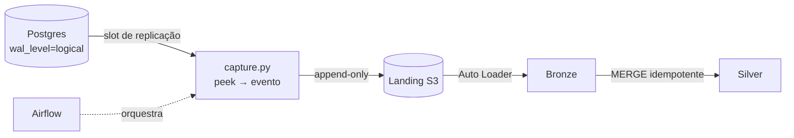

# lab-cdc

[](https://github.com/vitorpereirazp-code/lab-cdc/actions/workflows/ci.yml)


Laboratório de **Change Data Capture (CDC)** por log: uma réplica reduzida de uma
arquitetura de ingestão real. O objetivo é ver um `DELETE` atravessar o pipeline
inteiro, lendo o log do banco, sem consultar a tabela.



## Estrutura

```
lab-cdc/
├── .github/workflows/ci.yml   # lint + testes a cada push
├── infra/                     # banco de origem (Docker) e scripts SQL das etapas 1-2
├── databricks/                # notebooks: 01_bronze (Auto Loader) e 02_silver (MERGE)
├── src/lab_cdc/               # captura, landing e lógica da silver
└── tests/                     # unitários (sem banco) e integração (com banco)
```

## Status

| Etapa | O que faz | Status |
|---|---|---|
| 1 | Origem transacional com replicação lógica | ✅ |
| 2 | Ler o log cru (`peek` vs `get`) | ✅ |
| 3 | Captura em Python com testes | ✅ |
| 4 | Landing (Volume do Databricks agora, S3 depois) | ✅ |
| 5 | Bronze e silver no Databricks (Auto Loader + MERGE) | ✅ |
| 6 | Orquestração com Airflow | ✅ |

## Etapa 1 · Origem transacional (~1h)

```bash
cd infra
docker compose up -d
docker exec -it lab-cdc-postgres psql -U lab -d origem -c "SHOW wal_level;"
```

Checkpoint:
- [ ] `docker compose up -d` sobe sem erro
- [ ] `SHOW wal_level;` retorna `logical`
- [ ] a tabela `loja` existe e aceita INSERT

## Etapa 2 · Ver o log com os próprios olhos (~30 min)

Execute `infra/etapa2_ver_o_log.sql` passo a passo.

Checkpoint:
- [ ] você viu os 4 eventos no log
- [ ] entende por que o DELETE traz a linha inteira (REPLICA IDENTITY FULL)
- [ ] sabe a diferença entre peek e get

## Etapa 3 · Captura em Python (~2h)

Pré-requisito: Etapa 2 feita. Instale o [uv](https://docs.astral.sh/uv/) e, na raiz do repositório:

```powershell
uv sync
uv run pytest      # testes unitários, não precisam de banco
```

Para ler o slot de verdade, aponte para o seu banco (PowerShell) e rode:

```powershell
$env:PGHOST="localhost"; $env:PGUSER="postgres"; $env:PGDATABASE="postgres"
$env:PGPASSWORD="sua-senha"
uv run python -m lab_cdc
```

Isso faz `peek`: imprime os eventos em JSON e não consome nada. Para o teste ponta a ponta
(cria uma tabela e um slot próprios e apaga no final, sem mexer na sua `loja`):

```powershell
$env:LAB_CDC_INTEGRACAO="1"
uv run pytest
```

A ordem correta do pipeline, que a Etapa 4 vai completar: `ler_slot` (peek) -> gravar na
landing -> `confirmar`. Se a gravação falhar, a posição do slot não avançou e nada se perde.

Checkpoint:
- [ ] `uv run pytest` passa sem banco ligado
- [ ] `uv run python -m lab_cdc` mostra os 4 eventos, com o DELETE trazendo a linha inteira
- [ ] você sabe explicar por que `confirmar` vem depois de gravar, e não antes
- [ ] o CI do GitHub Actions ficou verde no primeiro push

## Etapa 4 · Landing (~30 min)

Grava os eventos como JSON Lines, particionados por data e hora, e só depois avança o slot:

```powershell
uv run python -m lab_cdc --gravar landing
```

Envie a pasta para o Volume do Databricks (o notebook 01 cria o Volume na primeira execução):

```powershell
databricks fs cp -r landing/loja dbfs:/Volumes/lab_cdc/bronze/landing/loja --overwrite --profile lab
```

Por enquanto a landing é um Volume. Quando a AWS estiver pronta, o destino vira um bucket S3
e o formato continua igual.

## Etapa 4b · Ponte S3 → Volume (~15 min)

O Free Edition não permite *external location*, então o Databricks não lê o bucket direto.
Este passo copia para o Volume só os arquivos do S3 que ainda não estão lá:

```powershell
uv run python -m lab_cdc --s3 lab-cdc-vitor-2026      # Postgres -> S3
uv run python -m lab_cdc.replicar --bucket lab-cdc-vitor-2026   # S3 -> Volume
```

Rodar a réplica duas vezes não copia nada de novo. Numa conta paga, este passo some: o
Auto Loader leria `s3://` direto.

## Etapa 5 · Bronze e silver (~1h)

1. No Databricks: **Workspace → Create → Git folder**, com a URL deste repositório.
2. Rode `databricks/01_bronze` uma vez (cria o Volume) e envie a landing (Etapa 4).
3. Rode `01_bronze` de novo: o Auto Loader lê só os arquivos novos.
4. Rode `databricks/02_silver`: o MERGE aplica os eventos em ordem de LSN.

Prova do delete: a loja 2 não pode existir na silver, e a loja 1 tem que estar como PF.

O MERGE é idempotente: reprocessar o mesmo lote não muda nada, e um evento mais antigo que o
estado atual é ignorado. Os testes em `tests/test_silver.py` rodam no CI com Spark e Delta.

## Etapa 6 · Airflow orquestrando captura e réplica

A DAG `lab_cdc_ingestao` roda a cada 15 minutos, em Docker, no seu PC:

```
capturar (Postgres -> S3)  ->  replicar (S3 -> Volume)  ->  o job do Databricks dispara sozinho
```

| Proteção | Por quê |
|---|---|
| `catchup=False` | Ao ligar, não reexecuta os ciclos passados: o slot já guarda o atraso inteiro |
| `max_active_runs=1` | Duas execuções lendo o mesmo slot poderiam gravar o mesmo evento duas vezes |
| `retries=2`, a cada 2 min | Falha passageira (rede, Postgres reiniciando) se recupera sozinha |
| `replicar` roda mesmo sem eventos | Recupera um arquivo que ficou para trás num ciclo anterior |

**Como subir (uma vez):**

1. Crie um token no Databricks: avatar → **Settings → Developer → Access tokens → Generate**, com validade de 90 dias.
2. Copie `airflow/.env.example` para `airflow/.env` e preencha a senha do Postgres e o token. O `.env` está no `.gitignore`.
3. Suba:
   ```powershell
   cd airflow
   docker compose up -d --build
   ```
4. Abra http://localhost:8080 e ligue a DAG `lab_cdc_ingestao` (botão de pausa).

O código de `src/` é montado no container: mudou o código, vale no próximo ciclo, sem reconstruir.
Para parar: `docker compose down` (o histórico do Airflow fica guardado no volume `estado`).

## Próximas etapas

Exercícios de consolidação: SCD tipo 2 na silver, backfill a partir da landing e
`timestamptz` na origem.

## Regras

- Uma vez, não perfeitamente. Travou mais de 1h? Simplifique ou pule.
- Credenciais deste laboratório são locais (lab/lab). Nunca exponha a porta.
